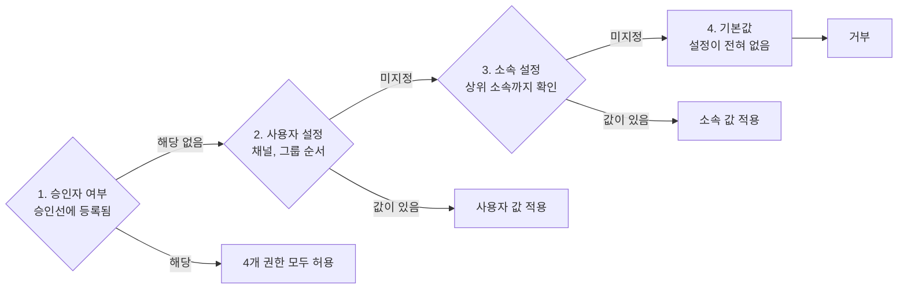
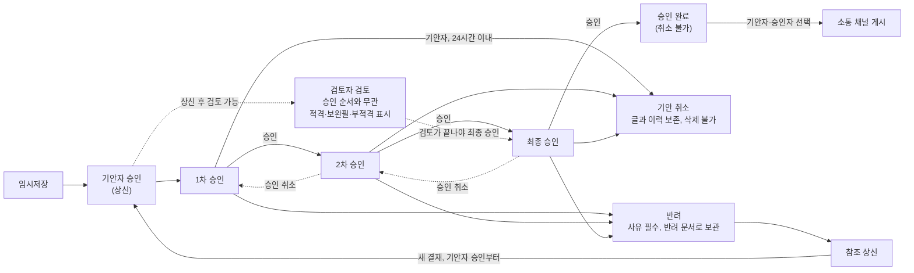
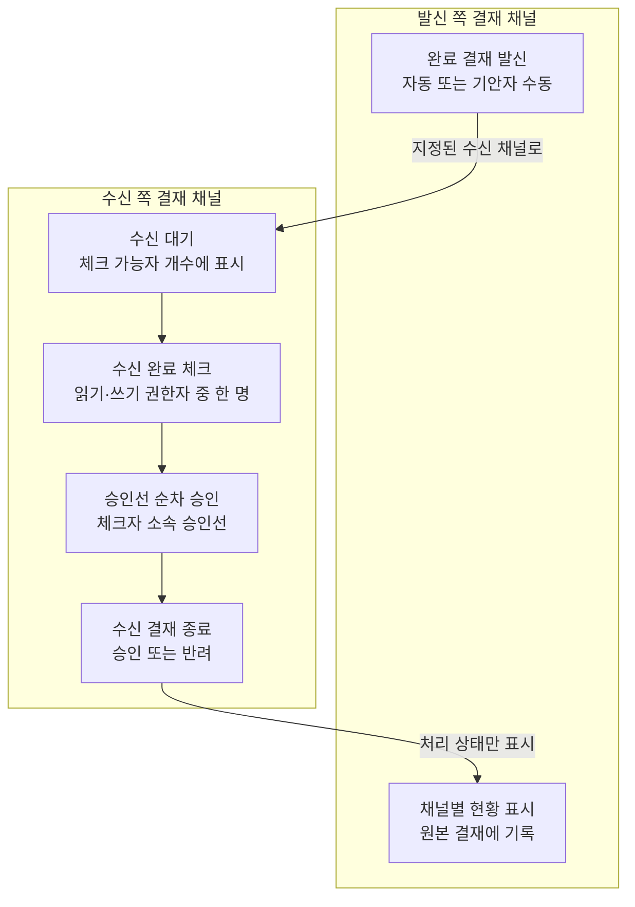
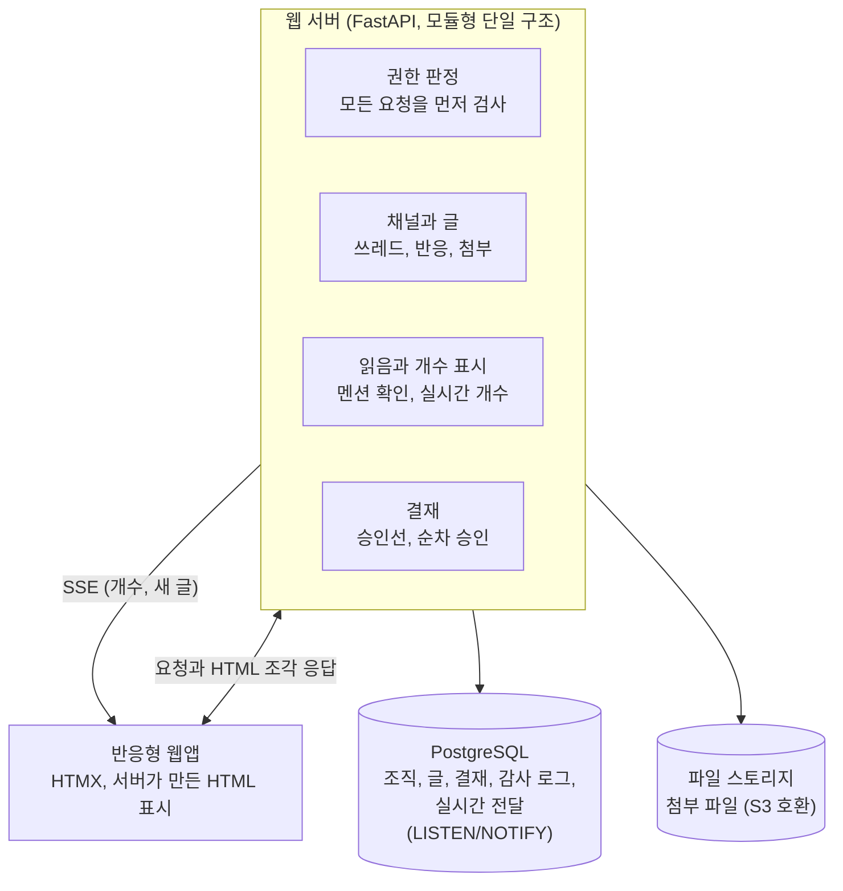

# 바로채널 개발 기획서

2026-11-05 · 박실장님

## 개요

디스코드의 그룹·채널 구조에 회사 업무에 필요한 세 가지를 더한 사내 소통 시스템 바로채널(BaroChannel)을 만든다. 세 가지는 조직 기반 권한, 필수 읽음 확인, 순차 결재다.

메신저는 대화가 흘러가 버리고, 그룹웨어는 무겁고 대화와 분리된다. 이 시스템은 대화·투표·문서·결재를 한 화면의 채널로 묶고, 누가 읽었고 누가 승인했는지를 기록으로 남긴다.

**핵심 원칙**

- 사용자에게 준 권한이 소속 권한보다 항상 우선한다.
- 멘션된 사람의 읽음은 시스템이 끝까지 추적한다.
- 최종 승인이 끝난 결재는 누구도 취소할 수 없고, 승인·취소·읽음 확인 이력과 상신된 결재 문서는 고칠 수 없고, 5년 동안 삭제할 수 없다.

**용어**

| 용어 | 뜻 |
| --- | --- |
| 소속 | 회사의 조직 단위(본부, 팀 등). 트리 구조이며 권한을 가질 수 있다 |
| 그룹 | 채널을 묶는 상위 공간. 디스코드의 서버에 해당한다 |
| 채널 | 실제 글이 쌓이는 공간. 소통·투표·문서·결재 4가지 유형이 있다 |
| 글 | 채널에 올리는 최상위 게시물 |
| 쓰레드 | 글 하나에 달리는 답글 묶음 |
| 반응 | 글이나 답글에 붙이는 이모지 표시 |
| 승인선 | 결재 글이 거치는 기안자와 1차~최종 승인자의 순서 |
| 검토자 | 승인선과 별개로 결재 문서를 검토해 결과만 남기는 사람 |
| 발신 | 최종 승인된 결재를 지정된 수신 채널로 보내는 일 |
| 수신 결재 | 수신 완료 체크 후 수신 채널에서 새로 진행하는 결재 |

요청서의 "결제"는 승인 절차를 뜻하므로 이 문서에서는 "결재"로 적는다.

## 조직과 공간 구조

시스템은 사람 축(회사 > 소속 > 사용자)과 공간 축(그룹 > 채널 > 글 > 쓰레드)으로 나뉘고, 권한이 두 축을 잇는다.

사용자는 하나 이상의 소속에 속한다. 그룹을 만들고 그 안에 유형을 골라 채널을 추가한다. 채널 유형은 만들 때 정하고 이후 바꿀 수 없다.

| 채널 유형 | 용도 | 글의 형태 | 고유 기능 |
| --- | --- | --- | --- |
| 소통 | 일상 대화, 공지, 업무 협의 | 시간순 글 | 글 고정 |
| 투표 | 의견 수렴, 일정·안건 결정 | 투표 글 | 선택지, 마감일, 결과 집계, 글 고정 |
| 문서 | 규정, 매뉴얼, 회의록 보관 | 제목이 있는 문서 | 버전 이력, 목록·검색, 글 고정 |
| 결재 | 지출, 휴가, 품의 등 승인 | 결재 문서 | 기본 형식, 승인선, 순차 승인, 상태 관리, 완료 결재 게시, 발신·수신 |

쓰레드, 반응, 마크다운, 첨부, @멘션은 네 유형 모두에서 같게 동작한다.

## 기능 요구사항

공통 기능은 한 번 만들어 네 채널 유형이 함께 쓰고, 유형별 기능은 그 위에 얹는다. 이 표의 "가정"은 요청에 없어 기획에서 제안한 내용이다.

### 그룹과 채널

| ID | 요구사항 | 비고 |
| --- | --- | --- |
| F-01 | 그룹 생성·수정·보관 | 생성자는 관리자 또는 그룹 생성 권한자 |
| F-02 | 그룹 안에 채널 추가, 유형 선택 | 소통·투표·문서·결재 |
| F-03 | 채널 순서 변경, 채널별 권한 설정 | 권한은 권한 모델 장 참고 |

### 글, 쓰레드, 반응

| ID | 요구사항 | 비고 |
| --- | --- | --- |
| F-10 | 쓰기 권한자가 채널에 글 작성 | 마크다운 본문, 미리보기 제공 |
| F-11 | 글에 쓰레드로 답글 작성 | 쓰레드는 1단계만 둔다 |
| F-12 | 글과 답글에 반응 추가·취소 | 이모지별 인원 집계, 누른 사람 보기. 읽기 권한자는 반응 가능 |
| F-13 | 글 수정·삭제 | 본인 글만. 수정됨 표시와 이력 보관. 삭제는 F-17, F-18 적용. 문서 채널 문서는 F-43 적용. 상신된 결재 문서는 F-62 보존 규칙 적용 |
| F-14 | 첨부 파일 추가 | 여러 개 첨부, 이미지 미리보기. 글을 볼 수 있는 사람만 다운로드 |
| F-15 | 채널·그룹 내 검색 | 볼 수 있는 글만 결과에 나온다 |
| F-16 | 소통·투표·문서 채널의 글을 상단에 고정 | 결재 채널 제외. 채널 관리자가 고정·해제한다. 고정 개수는 관리자가 채널별로 지정하고 기본은 5개 |
| F-17 | 삭제된 글 표시와 이력 보관 | 글과 답글을 지워도 자리에 "삭제된 글" 표시가 남고, 본문과 이력은 보관. 검색과 미확인 개수에서는 제외 |
| F-18 | 쓰레드가 달린 글의 삭제 제한 | 답글이 남아 있으면 삭제 불가. 답글 작성자가 모두 삭제한 뒤에 글을 삭제할 수 있다 |

### @멘션과 필수 읽음 확인

멘션된 사람은 글을 화면에서 본 것만으로는 완료되지 않고, "읽음 확인" 버튼을 눌러야 한다. 이렇게 해야 실수로 스크롤한 사람과 실제로 읽은 사람이 구분된다.

| ID | 요구사항 | 비고 |
| --- | --- | --- |
| F-20 | 본문에서 @이름으로 관련자 지정 | 자동완성. @소속은 소속원 전원을 대상으로 펼친다 |
| F-21 | 대상자의 미확인 개수에 반영하고 "읽음 확인" 버튼 표시 | 버튼을 누른 시각을 기록, 취소 불가 |
| F-22 | 글에 확인 현황 표시 | 예: 3/5 확인. 누르면 미확인자 명단 표시 |
| F-23 | 내 미확인 목록 | 확인할 때까지 목록에 남는다 |
| F-24 | 접속 시 미확인 글 개수 표시 | 별도 리마인드 발송 없이, 접속할 때 확인하지 않은 글의 개수를 보여준다. 접속 중에는 개수를 실시간으로 갱신 |
| F-25 | 채널 읽기 권한 없는 사람 멘션 시 처리 | 작성 시 경고하고 멘션을 막는다 |
| F-26 | 본문을 고친 뒤의 읽음 처리 | 작성자가 재확인 요청을 선택하면 다시 미확인이 된다 |

### 투표 채널

| ID | 요구사항 | 비고 |
| --- | --- | --- |
| F-30 | 쓰기 권한자가 투표 글 작성 | 안건, 선택지, 단일·복수 선택, 마감일 |
| F-31 | 읽기 권한자가 투표 | 마감 전 변경 가능. 변경 이력 보관 |
| F-32 | 기명·익명 선택, 결과 공개 시점 선택 | 작성자가 즉시 공개 또는 마감 후 공개 중에서 선택 |
| F-33 | 투표 통계에 변심자 수 표시 | 마감 전에 선택을 바꾼 사람의 수만 표시하고 명단은 보여주지 않는다. 익명 투표는 선택지별 인원수만 표시. 표시 시점은 F-32를 따른다 |

### 문서 채널

| ID | 요구사항 | 비고 |
| --- | --- | --- |
| F-40 | 쓰기 권한자가 제목이 있는 문서 작성 | 타임라인 대신 문서 목록으로 보여준다 |
| F-41 | 문서 수정 시 버전 이력 보관 | 이전 버전 조회만 제공. 비교·복원 기능은 없다 |
| F-42 | 문서에 답글·반응·멘션 | 공통 기능 그대로 |
| F-43 | 등록한 문서 삭제 불가 | 작성자와 관리자 모두 삭제할 수 없다. 답글은 F-13 규칙을 따른다 |

결재 채널의 요구사항은 결재 워크플로우 장에 따로 적는다.

## 권한 모델

권한은 채널별로 판정하며, 승인자 자동 부여 > 사용자 설정 > 소속 설정 > 기본 차단 순서로 먼저 만나는 값이 결과가 된다.

### 기본 권한 4종

| 권한 | 할 수 있는 일 | 선행 조건 |
| --- | --- | --- |
| 읽기 | 채널의 모든 글과 첨부를 본다 | 없음 |
| 쓰기 | 글을 작성한다. 읽기 없이 쓰기만 있으면 자신이 쓴 글만 본다 | 없음 |
| 답글읽기 | 쓰레드를 펼쳐 본다 | 읽기 또는 쓰기 |
| 답글쓰기 | 쓰레드에 답글을 작성한다 | 답글읽기 |

선행 조건은 화면에서 강제한다. 답글쓰기를 켜면 답글읽기가 같이 켜지고, 읽기와 쓰기를 모두 끄면 나머지가 모두 꺼진다. 쓰기만 있는 사람의 답글 권한은 자신이 쓴 글 안에서만 쓸 수 있다.

### 설정 방식

각 권한은 허용, 거부, 미지정 세 값을 가진다. 미지정은 "이 단계에서는 정하지 않음"이라는 뜻이고 다음 단계로 넘어간다. 거부가 있어야 "영업팀은 쓸 수 있지만 이 사용자만 제외"를 표현할 수 있다.

- 같은 대상이라면 채널 설정이 그룹 설정보다 우선한다. 그룹 설정은 채널 전체의 기본값이다.
- 소속에 설정이 없으면 상위 소속의 설정을 따른다.
- 겸직으로 소속이 둘 이상이면 하나라도 허용이면 허용한다.
- 시스템 관리자는 조직·그룹·채널을 관리한다. 시스템 관리자도 소속이 있는 사용자이므로 글 열람은 관리자 지위가 아니라 별도로 받은 권한으로 판정한다.

### 판정 예시

| 상황 | 사용자 설정 | 소속 설정 | 결과 |
| --- | --- | --- | --- |
| 영업팀원의 일반 쓰기 | 미지정 | 영업팀 허용 | 허용(소속이 기본) |
| 영업팀 인턴의 쓰기 | 거부 | 영업팀 허용 | 거부(사용자 우선) |
| 타 부서 협업자의 읽기 | 허용 | 개발팀 미지정 | 허용(사용자 우선) |
| 쓰기만 받은 영업팀원 | 미지정 | 영업팀 쓰기만 허용 | 자신이 쓴 글만 조회 |
| 아무 설정이 없는 사용자 | 미지정 | 미지정 | 거부(기본 차단) |
| 쓰기를 거부당한 승인자 | 거부 | 재무팀 미지정 | 허용(승인자 자동 부여) |

## 결재 워크플로우

기안자가 결재 글을 승인하면 상신되고, 기안자 소속의 승인선이 글에 복사된다. 이후 승인자가 1차부터 최종까지 한 명씩 차례대로 처리한다.

### 승인선 관리

승인선은 결재 채널 설정에서 소속별로 등록한다. 같은 "지출결의" 채널이라도 기안자 소속에 따라 다른 승인선이 적용된다. 단계 수에는 제한을 두지 않고, 마지막 단계가 최종 승인자가 된다.

| 결재 채널 | 기안 소속 | 1차 | 2차 | 최종 |
| --- | --- | --- | --- | --- |
| 지출결의 | 영업팀 | 영업팀장 | 영업본부장 | 재무이사 |
| 지출결의 | 개발팀 | 개발팀장 | CTO | 재무이사 |
| 휴가신청 | 영업팀 | 영업팀장 | - | 영업본부장 |

위 표는 설명을 위한 예시다. 승인선은 상신 시점에 글로 복사하므로, 나중에 설정을 바꿔도 진행 중인 결재는 영향을 받지 않는다.

기안자는 승인선의 첫 단계다. 기안자가 승인하면 그 시점에 상신되고, 등록된 1차 승인자부터 차례가 시작된다. 기안자가 등록 승인선의 중간 단계에도 있으면 그 단계는 빠진다. 기안자가 최종 승인자가 되는 결재는 없다. 기안자가 등록 승인선의 최종 승인자이면 시스템이 상신을 막는다.

승인자는 결재 채널별로 지정되고, 지정된 채널의 전체 권한을 기본으로 갖는다. 채널 읽기 권한자는 그 채널의 모든 결재 문서를 조회할 수 있고, 쓰기 권한만 있는 사람은 자신이 올린 결재만 볼 수 있다. 기안자 단계는 승인자 권한을 주지 않는다.

### 기본 형식과 검토자

결재 채널마다 기본 형식을 지정할 수 있고, 새 결재를 쓰면 그 형식이 본문에 채워진다. 기본 형식은 마크다운 틀로 만든다.

작성자는 상신할 때 검토자를 추가로 지정할 수 있다. 검토자는 승인선에 들지 않고 문서를 검토만 하며, 승인과 반려에는 관여하지 않는다.

- 기안자가 승인해 상신되면 바로 검토할 수 있고, 승인 순서와 상관없이 진행한다.
- 검토 결과는 적격, 보완필, 부적격 등으로 글에 표시만 한다. 부적격이어도 승인을 막지 않고, 최종 승인자가 결과를 보고 판단한다.
- 검토자가 있으면 최종 승인자는 모든 검토가 끝난 뒤에 승인할 수 있다. 1차와 중간 단계 승인은 검토를 기다리지 않는다.
- 검토자는 최종 승인 전까지 자기 결과를 바꿀 수 있고, 이력은 감사 로그에 남는다. 해당 글에 한해 읽기와 검토 권한만 받고, 검토 내용은 쓰레드에 기록한다.

### 상태 흐름

승인은 순차로만 진행되며, 자기 차례가 아닌 승인자의 버튼은 비활성화된다. 검토는 이 순서와 별개로 진행되고, 검토자가 있으면 최종 승인 버튼은 검토가 끝나야 활성화된다.

3단계 승인선 예시다.

최종 승인이 끝나면 글에 완료 표시가 붙고 기안자의 개수 표시에 반영된다. 단계 수는 승인선에 따라 늘거나 줄어든다.

### 승인 취소

승인자는 다음 승인자가 승인하기 전까지만 자기 승인을 취소할 수 있고, 최종 승인이 끝나면 최종 승인자를 포함해 아무도 취소할 수 없다.

| 시점 | 취소할 수 있는 사람 | 결과 |
| --- | --- | --- |
| 기안자 승인 후, 1차 승인 전 | 기안자(기안 취소만 가능) | 기안 취소 상태로 채널에 남는다 |
| 1차 승인 후, 2차 승인 전 | 1차 승인자 | 1차 차례로 돌아간다 |
| 2차 승인 후, 다음 단계 승인 전 | 2차 승인자 | 2차 차례로 돌아가고 1차 승인은 유지된다 |
| 다음 승인자가 이미 승인한 뒤 | 없음 | 앞 단계 승인은 확정된다 |
| 최종 승인 후 | 없음(최종 승인자 포함) | 승인 완료로 확정된다 |

취소하면 글의 승인 표시는 사라지지만 승인과 취소 이력은 감사 로그에 남는다. 차례를 기다리던 다음 승인자의 처리할 개수도 실시간으로 바뀐다. 기안자의 승인은 상신에 해당하므로 승인 취소 대신 기안 취소 규칙을 따른다.

### 기안 취소와 기록 보존

기안자는 상신 후 24시간 이내에만 결재를 취소할 수 있고, 그 안에 최종 승인이 끝나면 취소할 수 없다. 기안자는 기록을 남기기 위해 언제든 삭제할 수 없다. 24시간이 지나면 취소 버튼이 비활성화되고, 진행을 멈추려면 승인자에게 반려를 요청한다.

- 취소된 결재는 "기안 취소" 표시를 달고 채널에 그대로 남는다. 그때까지의 승인 이력도 보존한다.
- 상신된 결재 문서는 의무 보존 기간 5년 동안 기안자와 시스템 관리자 모두 삭제할 수 없다. 기간은 결재가 끝난 날부터 센다. 반려·취소 문서도 같다.
- 상신 전 임시저장 글만 삭제할 수 있다.
- 5년이 지나면 시스템 관리자가 삭제할 수 있고, 삭제하기 전까지는 계속 보존한다. 자동 삭제는 없다.

### 반려와 참조 상신

반려된 결재는 반려 문서로 채널에 보관되고 다시 진행할 수 없다. 기안자는 반려 문서를 포함해 자신이 볼 수 있는 다른 문서를 참조해 새 결재를 상신한다.

- 참조한 문서의 본문과 첨부를 불러와 고쳐 쓰고, 새 결재에는 참조 문서 링크가 남는다.
- 참조 상신은 새 결재이므로 기안자 승인부터 다시 진행해 현재 승인선을 적용하고, 기안 취소 24시간도 새로 센다.
- 취소한 결재의 내용을 다시 올릴 때도 같은 방식을 쓴다.

### 완료 결재 게시

최종 승인이 끝난 결재는 소통 채널에 게시해 전사나 부서에 알릴 수 있다. 민감한 결재가 자동으로 공개되지 않도록 게시는 사람이 직접 실행한다.

- 기안자와 승인선에 있는 승인자 누구나 "소통 채널에 게시" 버튼을 누르고 채널을 고를 수 있다.
- 게시자가 쓰기 권한을 가진 소통 채널만 고를 수 있다. 결재 채널 설정에서 기본 게시 채널을 지정할 수 있다.
- 게시 글에는 제목, 본문 사본, 승인선 결과, 원본 결재 링크가 들어간다. 첨부 포함 여부는 게시자가 고른다.
- 본문을 사본으로 넣으므로 결재 채널 읽기 권한이 없는 사람도 게시 글을 읽을 수 있다. 원본 링크는 권한이 있어야 열린다.
- 게시 글은 소통 채널의 일반 글처럼 쓰레드, 반응, @멘션, 글 고정을 쓸 수 있다.

### 완료 결재 발신과 수신

최종 승인이 끝난 결재는 결재 채널에 지정된 수신 채널로 자동 또는 수동으로 발신되고, 수신 부서가 수신 완료를 체크하면 그 채널에서 결재가 이어진다. 게시가 내용을 알리는 기능이라면, 발신은 다른 부서에 문서를 넘겨 그 부서의 결재를 받는 기능이다.

| 단계 | 처리자 | 규칙 |
| --- | --- | --- |
| 대상 지정 | 채널 관리자 | 결재 채널의 권한 설정에서 발신을 허용할 수신 채널을 지정하고, 채널마다 자동 발신 여부를 설정한다. 지정되지 않은 채널로는 발신할 수 없고, 수신 채널은 결재 채널만 가능하다 |
| 발신 | 시스템(자동), 글 작성자(수동) | 자동 발신으로 설정된 채널에는 최종 승인 즉시 발신된다. 글 작성자인 기안자는 나머지 지정 채널을 골라 수동으로 발신한다. 이미 발신했거나 수신한 채널로는 보낼 수 없다. 수신은 채널마다 따로 처리한다 |
| 수신 대기 | 시스템 | 제목, 본문 사본, 첨부, 승인선 결과, 원본 링크를 담은 글이 수신 채널에 올라오고 읽기 권한이 있는 쓰기 권한자의 수신 대기 개수에 표시된다. 읽기 권한이 있는 사람만 수신 대기 글은 볼 수 있다 |
| 수신 완료 | 수신 채널에서 읽기 권한이 있는 쓰기 권한자 중 한 명 | 한 명이 체크하면 그 채널의 수신이 끝난다. 동시에 눌러도 먼저 처리된 한 건만 성립하고, 체크는 취소할 수 없다 |
| 수신 결재 | 수신 채널 승인선 | 체크 즉시 수신 채널의 내부 상신 절차가 시작된다. 체크한 사람이 기안자가 되고 체크가 기안자 승인으로 처리되며, 그 사람 소속의 승인선이 적용된다 |

- 읽기와 쓰기 권한은 권한 판정 결과로 정하고, 쓰기 권한만 있는 사람은 체크할 수 없다. 승인자도 두 권한이 자동 부여되므로 체크할 수 있고, 체크하면 기안자 단계를 맡고 등록 승인선의 본인 단계는 빠진다. 단, 그 승인선의 최종 승인자는 체크할 수 없다.
- 승인선이 등록되지 않은 소속의 사람은 수신 완료를 체크할 수 없다.
- 수신 결재의 본문은 발신 문서의 사본이고 수정할 수 없다. 의견과 보완은 쓰레드로 남긴다.
- 수신은 거부할 수 없고, 수신 결재는 승인 또는 반려로 끝난다. 기안 취소는 없다. 승인 취소는 일반 결재와 같다.
- 수신 결재가 반려되면 수신 채널에 반려 상태로 남는다. 원본 결재는 완료 상태를 유지하고, 발신 채널에는 처리 상태만 표시한다.
- 원본 결재에는 수신 채널별로 수신 대기, 결재 중, 완료, 반려 현황을 표시한다. 원본 링크는 권한이 있어야 열린다.
- 승인이 끝난 수신 결재는 일반 완료 결재처럼 게시할 수 있고, 다른 채널로 다시 발신할 수 있다. 문서가 이미 발신했거나 수신한 채널은 수동 발신 대상에서 빠지고 자동 발신도 건너뛰므로, 같은 채널로 되돌아가지 않는다.

### 요구사항

| ID | 요구사항 | 비고 |
| --- | --- | --- |
| F-50 | 소속별 승인선 등록·수정 | 1차, 2차, …, 최종의 단계별 승인자 |
| F-51 | 결재 글 상신 | 기안자가 승인하면 상신. 글 상단에 적용될 승인선 미리보기 |
| F-52 | 현재 차례의 승인자에게 처리할 개수 표시 | 다음 단계로 넘어가면 다음 승인자의 개수에 실시간 반영 |
| F-53 | 승인 처리를 반응처럼 표시 | 반응 줄 자리에 단계·이름·시각을 담은 승인 표시. 일반 반응과 달리 F-61 조건에서만 취소 가능 |
| F-54 | 승인자의 기본 권한 자동 부여 | 승인선에 등록된 채널에서 읽기·쓰기·답글읽기·답글쓰기 모두 허용. 기안자 단계는 제외 |
| F-55 | 반려 | 사유 필수. 반려 문서로 보관, 기안자의 개수 표시에 반영 |
| F-56 | 참조 상신 | 반려 문서나 다른 문서를 참조해 새 결재로 상신. 기안자 승인부터 진행 |
| F-57 | 기안 취소 | 기안자가 상신 후 24시간 이내, 최종 승인 전에만 가능. 글은 삭제되지 않고 취소 상태로 남는다 |
| F-58 | 본문 잠금 | 상신 후 본문·첨부 수정 불가, 보완은 쓰레드로 한다 |
| F-59 | 내 결재함 | 내가 처리할 건, 검토할 건, 수신 대기 건, 내가 올린 건, 완료한 건 |
| F-60 | 부재 시 대결 | 대결자 없음, 결제자 부재시 앞 승인자가 승인 취소하여 결제선 재지정 하거나 새로 기안해야함 |
| F-61 | 승인 취소 | 다음 승인자 승인 전까지 본인 승인만 취소. 최종 승인은 취소 불가 |
| F-62 | 결재 문서 의무 보존 | 5년간 기안자와 관리자 모두 삭제 불가. 이후 관리자가 삭제할 때까지 보존 |
| F-63 | 완료 결재의 소통 채널 게시 | 최종 승인 후 기안자와 승인선의 승인자가 게시. 게시 이력은 감사 로그에 기록 |
| F-64 | 발신 대상 채널 지정 | 결재 채널 권한 설정에서 지정. 지정된 결재 채널로만 발신 가능. 채널별 자동 발신 설정 |
| F-65 | 완료 결재 발신 | 자동 발신 채널은 최종 승인 즉시 발신. 그 외 지정 채널은 글 작성자가 수동 발신. 여러 채널 동시 발신 가능 |
| F-66 | 수신 완료 체크 | 수신 채널에서 읽기 권한이 있는 쓰기 권한자 중 한 명이 체크. 먼저 처리된 한 건만 성립, 취소 불가 |
| F-67 | 수신 결재 자동 상신 | 체크한 사람이 기안자, 체크가 곧 기안자 승인. 그 사람 소속의 승인선 적용 |
| F-68 | 발신·수신 현황 표시 | 발신 채널에는 수신 결재의 처리 상태만 표시. 발신과 수신 완료는 감사 로그에 기록 |
| F-69 | 결재 기본 형식 | 결재 채널별 지정. 새 결재 본문에 자동 입력 |
| F-70 | 검토자 추가 지정 | 작성자가 상신 시 지정. 승인선에 들지 않고 승인 순서와 상관없이 검토. 읽기와 검토 권한만 부여 |
| F-71 | 승인선에 기안자 포함 | 기안자 승인이 첫 단계이고, 기안자가 승인하면 상신된다. 기안자는 최종 승인자가 될 수 없다 |
| F-72 | 검토 결과 표시 | 적격, 보완필, 부적격 등 결과만 글에 표시하고 검토 내용은 쓰레드에 기록. 승인·반려에는 관여하지 않음 |
| F-73 | 검토 완료 후 최종 승인 | 검토자가 있으면 모든 검토가 끝나야 최종 승인 가능 |

## 화면 구성

메인 화면은 디스코드와 같은 4단 구조로 만들고, 업무 기능은 글 카드 안에 넣는다. 사용자는 화면을 옮기지 않고 승인과 읽음 확인을 처리한다. 버튼을 누르면 해당 글 카드만 서버에서 다시 받아 바꾼다.

결재 채널을 연 상태의 예시다.

| 그룹 | 채널 목록 | 글 타임라인 | 쓰레드 |
| --- | --- | --- | --- |
| 전사 **영업** 개발 | **영업본부** 소통: # 공지, # 일반 투표: # 일정 조율 문서: # 규정집 결재: **# 지출결의**  내 미확인 3건 내 결재함 2건 | **# 지출결의** 영업팀 기안자 · 10:12 **전시회 부스 비용 결재 요청** @영업팀장 @재무담당 검토 바랍니다 [견적서.pdf] [검토: 재무담당 적격] [기안 승인] [1차 승인] **[2차 차례]** [최종 대기] 반응 추가 · 읽음 확인 1/2 · 답글 2개 **[승인]** [반려] [읽음 확인]  마크다운 입력, @멘션, 파일 첨부 | 재무담당 · 10:40 계산서 첨부 부탁합니다  기안자 · 10:52 답글에 첨부했습니다  답글 입력 |

왼쪽부터 그룹, 채널 목록, 글 타임라인, 쓰레드 패널이다. 승인 표시는 반응과 같은 위치에 칩으로 나타나고, 승인·반려 버튼은 현재 차례의 승인자에게만 활성화된다. 검토 결과도 글 카드 안에 칩으로 보여준다.

| 화면 | 주요 내용 | 사용 대상 |
| --- | --- | --- |
| 메인 | 그룹, 채널, 고정 글, 글 타임라인, 쓰레드 | 전체 |
| 내 할 일 | 미확인 글 개수와 목록, 처리할 결재, 검토할 결재, 수신 대기 문서, 내가 올린 결재 | 전체 |
| 투표 글 | 선택지, 진행률, 마감 시각, 결과, 변심자 수 | 전체 |
| 문서 목록·보기 | 문서 목록, 본문, 버전 이력 | 전체 |
| 결재 작성 | 기본 형식, 마크다운 편집기, 첨부, 참조 문서, 검토자 지정, 승인선 미리보기 | 기안자 |
| 채널 설정 | 소속·사용자별 권한 표, 고정 개수, 승인선 편집, 기본 형식, 발신 대상·자동 발신 설정 | 채널 관리자 |
| 조직 관리 | 소속 트리, 사용자 등록, 소속 배정 | 시스템 관리자 |
| 감사 로그 | 권한 변경, 승인 이력 조회 | 시스템 관리자 |

## 데이터 모델

핵심 테이블은 23개이고, 채널 유형별 기능은 공통 `post`에 확장 테이블을 붙이는 방식으로 담는다. 덕분에 쓰레드·반응·첨부·멘션은 유형과 상관없이 한 벌만 구현한다.

| 영역 | 테이블 | 주요 컬럼 |
| --- | --- | --- |
| 조직 | `department` | id, parent_id, name |
| 조직 | `user` | id, name, email, password_hash, auth_provider, external_id, status |
| 조직 | `user_department` | user_id, department_id, is_primary |
| 공간 | `workspace_group` | id, name, created_by, archived_at |
| 공간 | `channel` | id, group_id, type(talk/vote/doc/approval), name, sort_order, default_publish_channel_id, approval_template_md, pin_limit(기본 5) |
| 권한 | `permission_grant` | scope_type(group/channel), scope_id, subject_type(user/department), subject_id, can_read, can_write, can_reply_read, can_reply_write (각각 allow/deny/null) |
| 콘텐츠 | `post` | id, channel_id, parent_post_id(답글이면 값 있음), author_id, body_md, pinned_at, pinned_by, edited_at, deleted_at, deleted_by |
| 콘텐츠 | `post_revision` | post_id, version, body_md, edited_by, created_at |
| 콘텐츠 | `attachment` | id, post_id, file_name, storage_key, size, mime |
| 콘텐츠 | `reaction` | post_id, user_id, emoji |
| 읽음 | `mention_ack` | post_id, user_id, source_department_id, acked_at |
| 투표 | `poll`, `poll_option`, `poll_vote` | post_id, multi_select, anonymous, result_open(immediate/after_close), closes_at / option_id, user_id |
| 투표 | `poll_vote_history` | poll_id, user_id, before_option_ids, after_option_ids, changed_at |
| 결재 | `approval_line_template` | channel_id, department_id, step_no, approver_id, is_final |
| 결재 | `approval` | post_id, drafter_id, status, current_step, submitted_at, closed_at, published_post_id, reference_post_id, retain_until |
| 결재 | `approval_step` | approval_id, step_no, step_type(draft/approve), approver_id, status, comment, acted_at |
| 결재 | `approval_review` | approval_id, reviewer_id, result(미완료면 비움), thread_post_id, reviewed_at |
| 결재 | `channel_dispatch_target` | source_channel_id, target_channel_id, auto_send |
| 결재 | `approval_dispatch` | id, root_approval_id, source_approval_id, target_channel_id, send_type(auto/manual), sent_by(자동이면 비움), sent_at, received_by, received_at, received_approval_id |
| 공통 | `notification` | user_id, type, ref_id, read_at |
| 공통 | `audit_log` | actor_id, action, target_type, target_id, detail, created_at |

테이블 설계의 세 가지 포인트는 다음과 같다.

- `permission_grant`는 사용자와 소속을 한 테이블에 담는다. 판정 순서는 코드 한 곳에만 둔다.
- `approval_step`은 상신 시점의 승인선 사본이다. `approval_line_template`을 바꿔도 영향을 받지 않는다.
- `mention_ack`는 멘션 대상자마다 한 행을 만든다. `acked_at`이 비어 있는 행이 곧 미확인 목록이고, 접속할 때 이 행을 세어 개수를 보여준다.

## 기술 구성과 비기능 요구사항

FastAPI, PostgreSQL, HTMX를 기준으로 설계한다. FastAPI 서버 하나가 화면과 업무 처리를 함께 맡는 모듈형 단일 구조로 만들고, 화면은 서버가 만든 HTML 조각을 HTMX로 교체해 그린다. 사용자 500명 이하 규모에서는 마이크로서비스의 운영 부담이 이득보다 크다. 검색도 별도 엔진 없이 PostgreSQL 전문 검색으로 시작한다. 같은 이유로 Redis를 두지 않고, 서버 간 실시간 전달도 PostgreSQL로 처리한다.

| 영역 | 권장 기술 | 선택 이유 |
| --- | --- | --- |
| 프론트엔드 | HTMX, Jinja2 템플릿, 반응형 CSS | 서버가 HTML 조각을 돌려주므로 별도 프론트엔드 빌드와 상태 관리가 필요 없다 |
| 백엔드 | FastAPI(Python), SQLAlchemy, Alembic | 비동기 처리와 SSE를 지원하고, 의존성 주입으로 모든 경로에 권한 검사를 강제한다 |
| 인증 | 1차 이메일 로그인(쿠키 세션), 이후 SSO 연결 | 인증 모듈을 분리해 SSO를 붙여도 조직·권한 코드는 바뀌지 않는다 |
| 데이터베이스 | PostgreSQL | 결재에 필요한 트랜잭션과 한글 전문 검색 확장이 가능하다 |
| 실시간 | SSE(HTMX SSE 확장), PostgreSQL LISTEN/NOTIFY | 새 글·반응·승인과 개수를 즉시 반영한다. 화면으로 보내는 한 방향 전달이면 충분하고, 서버를 늘려도 구성 요소가 늘지 않는다 |
| 파일 | S3 호환 스토리지(MinIO 또는 클라우드) | 사내 설치와 클라우드 모두 같은 코드로 운영한다 |
| 알림 | 접속 중 개수 표시(실시간 갱신). 웹 푸시·이메일은 최소화 | 업무 방해를 줄이면서 필수 읽음과 결재 차례를 놓치지 않게 한다 |

### 비기능 요구사항

- **권한 검사**: 모든 요청과 실시간 전송을 서버에서 검사한다. FastAPI 의존성으로 걸어 HTML 조각 응답도 빠지지 않게 한다. 쓰기 권한만 있는 사람에게는 본인 글만 내려보낸다. 화면에서 버튼을 숨기는 것은 보안으로 치지 않는다.
- **판정 성능**: 500명 이하 규모이므로 별도 캐시 서버를 두지 않는다. 권한 테이블에 인덱스를 두고, 한 요청 안에서는 판정 결과를 재사용한다.
- **승인 정합성**: 승인과 취소는 트랜잭션과 행 잠금으로 묶는다. 취소와 다음 승인이 동시에 들어오면 먼저 처리된 쪽만 성립한다. 수신 완료 체크도 같은 방식으로 한 건만 성립한다. 최종 승인은 검토 완료 여부를 같은 트랜잭션에서 확인한다.
- **감사 로그**: 권한 변경, 승인·취소·반려, 기안 취소, 검토 결과, 결재 게시, 결재 발신, 수신 완료, 읽음 확인, 삭제를 추가 전용 로그에 남긴다.
- **첨부 보안**: 다운로드는 권한을 확인한 뒤 짧은 유효기간의 서명 URL로 제공한다. 파일 크기와 형식을 제한한다.
- **마크다운 보안**: 서버에서 렌더링하면서 HTML을 정제해 스크립트 삽입(XSS)을 막는다. HTML 조각을 만드는 템플릿은 자동 이스케이프를 켠다.
- **요청 보안**: 쿠키 세션을 쓰므로 모든 변경 요청에서 CSRF 토큰을 확인한다.
- **통신·저장**: HTTPS를 강제하고 일일 백업을 수행한다. 퇴사자 계정은 비활성화만 하고 기록은 보존한다.
- **사용자 규모**: 사용자 500명 이하를 기준으로 서버 구성과 부하 점검 범위를 잡는다.
- **로그인**: 1차 개발은 이메일 로그인으로 만들고, 사내 계정 연동(SSO)을 나중에 붙일 수 있게 설계한다. 사용자는 이메일이 아닌 내부 id로 식별한다.
- **접속 환경**: 1차 개발은 모바일 앱 없이 반응형 웹앱으로 만들어 PC와 휴대폰 브라우저에서 함께 쓴다.
- **설치 환경**: 사내 서버와 클라우드 모두에 설치할 수 있게 같은 코드로 만들고, 환경 차이는 설정으로 분리한다.
- **문서 보존**: 결재 문서만 5년간 의무 보존하고, 이후에도 관리자가 삭제할 때까지 보존한다. 문서 채널의 문서는 삭제할 수 없어 계속 남는다. 저장 용량은 이 기준으로 잡는다.
- **알림 방식**: 실시간 알림은 가능한 한 제한한다. 접속 중에는 읽어야 할 문서, 처리할 결재 등의 개수를 화면에 표시하고, 이 숫자는 실시간으로 갱신한다.

## 개발 단계

4단계로 나눠 약 24주에 전사 오픈을 목표로 한다. 이 기간은 개발자 2~3명을 가정한 추정치이며, 인원과 결정 사항이 확정되면 다시 산정한다.

| 단계 | 기간 | 내용 | 완료 관문 |
| --- | --- | --- | --- |
| 1단계 소통 기반 | 8주 | 이메일 로그인, 조직, 권한 / 그룹과 채널 / 글, 쓰레드, 반응, 고정 / 마크다운, 첨부 / 실시간 전송 | 관문 1: 권한 판정 테스트 통과 |
| 2단계 업무 핵심 | 6주 | @멘션, 필수 읽음 / 실시간 개수 표시 / 승인선, 순차 승인, 검토 / 반려, 취소, 참조 상신 / 내 할 일, 결재함, 게시 | 관문 2: 결재 전 과정 시연 완료 |
| 3단계 채널 확장 | 6주 | 투표 채널 / 문서 채널, 버전 이력 / 검색 / 결재 발신·수신 / 감사 로그 화면 | 관문 3: 보안, 부하 점검 완료 |
| 4단계 시범과 오픈 | 4주 | 한 부서 시범 운영 / 피드백 반영 / 조직 데이터 등록 / 전사 오픈 | |

권한 판정은 1단계에 넣는다. 나중에 넣으면 모든 요청과 실시간 전송을 다시 고쳐야 하기 때문이다. 결재는 투표·문서보다 먼저 만든다. 이 시스템이 일반 메신저와 달라지는 핵심이고 설계 위험도 가장 크기 때문이다. 결재 발신과 수신은 2단계 결재가 검증된 뒤 3단계에 넣는다.

## 결정이 필요한 사항

개발 착수를 막는 미결정 사항은 없다. 본문에 "가정"으로 표시한 항목만 착수 전에 검토한다.
