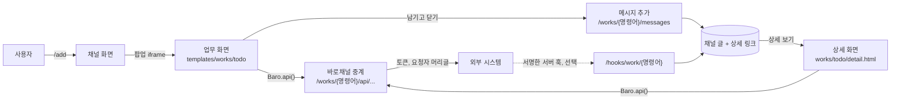
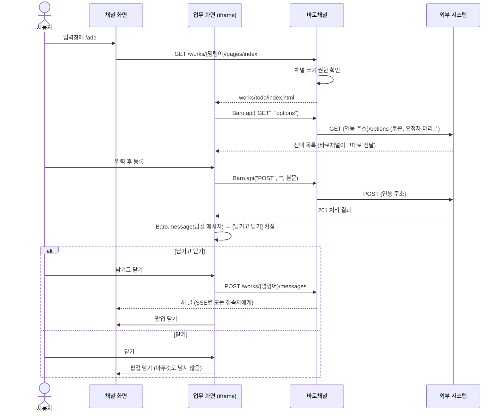

# 업무 채널 기획

2026-11-10 · 기준 문서 [barochannel.md](barochannel.md) · 상태: 확정, 개발 완료 · 개발 가이드 [work_integration_guide.md](work_integration_guide.md)

## 1. 개요

채널 유형에 **업무**를 더한다. 업무 채널에서 `/add`처럼 명령어를 입력하면 그 업무를 처리하는 화면이 팝업으로 열린다. 화면은 필요한 외부 시스템 API를 바로채널을 거쳐 부르며 일을 처리하고, 사용자가 **남기고 닫기**를 고르면 화면이 정한 메시지가 채널에 새 글로 남는다. 메시지에는 상세 화면 링크를 달 수 있고, 권한이 있는 사람은 메시지를 읽고 쓰레드로 의견을 나눈다.

업무 처리와 데이터는 외부 시스템(할 일, ERP, 설비 관리 등)이 맡는다. 바로채널은 화면을 띄우고, 화면의 API 호출을 안전하게 중계하고, 사람이 남기기로 한 기록을 채널에 쌓는 자리가 된다. 첫 연동 대상으로 샘플 할 일 시스템과 그 화면을 함께 만들어 구조를 검증했다.

**용어**

| 용어 | 뜻 |
| --- | --- |
| 업무 채널 | 명령어로 업무 화면을 열고, 처리 결과를 메시지로 남기는 채널. 다섯 번째 채널 유형 |
| 명령어 | `/`로 시작하는 업무 이름. 예: `/add`. 채널마다 등록하고, 열 화면과 연동 주소를 정한다 |
| 업무 화면 | `templates/works/{화면}/`에 코드로 둔 화면. 시작 화면과 상세 화면이 있다 |
| 화면 정의 | 화면 폴더의 `screen.toml`. 시작 화면, 상세 화면, 부를 수 있는 API를 적는다 |
| 연동 주소 | 명령어가 부르는 외부 시스템의 기준 주소. 예: `http://todo.internal/todos` |
| 중계 | 화면의 API 호출을 바로채널이 받아 토큰과 요청자 정보를 붙여 외부 시스템에 보내는 것 |
| 업무 메시지 | 화면이나 서버 훅이 채널에 남긴 글. 본문, 항목, 상세 링크, 외부 링크로 이뤄지고 고치지 않는다 |
| 상세 화면 | 메시지의 **상세 보기**로 여는 화면. 외부 시스템에서 최신 상태를 불러온다 |
| 서버 훅 | 외부 시스템이 서명한 요청으로 채널에 직접 메시지를 남기는 주소 |

## 2. 핵심 원칙

- **화면은 업무마다 만든다.** 폴더 하나가 업무 하나다. 바로채널 본체는 업무가 늘어도 고치지 않는다.
- **데이터는 외부 시스템에만 있다.** 바로채널은 업무 데이터의 사본을 두지 않고, 상태를 맞추지 않는다.
- **채널에 남기는 것은 사람이 정한다.** 처리를 끝내도 글이 자동으로 올라가지 않는다. **남기고 닫기**를 누를 때만 남고, **닫기**를 누르면 아무것도 남지 않는다.
- **남길 메시지는 화면이 정한다.** 업무마다 시스템이 요구하는 내용이 다르므로 본문과 항목은 각 화면이 만든다. 바로채널은 형식과 길이만 검사하고 미리보기는 두지 않는다.
- **메시지는 추가만 한다.** 남긴 메시지는 고치지 않는다. 상태가 바뀌면 새 메시지를 남긴다. 채널은 그 시점의 기록을 순서대로 쌓는다.
- **연결 정보와 권한은 바로채널이 쥔다.** 토큰은 브라우저로 가지 않는다. 화면이 부를 수 있는 API는 화면 정의에 적힌 것뿐이다.
- **최종 판단은 외부 시스템이 한다.** 바로채널은 "이 채널에서 이 업무를 쓸 수 있는 사람"까지만 보장하고, 데이터 단위의 권한과 입력 검사는 외부 시스템이 요청자 기준으로 한다.
- **업무 메시지도 `post`다.** 쓰레드, 반응, 글 고정, 검색, 새 글 수는 다른 채널과 똑같이 동작한다. 권한은 기존 4종을 그대로 쓴다.

## 3. 구성



## 4. 동작 흐름



## 5. 업무 화면

```
src/app/templates/works/
  base.html              # 공통 틀: 공통 CSS, SDK, 컨텍스트, [닫기]·[남기고 닫기]
  todo/
    screen.toml          # 화면 정의
    index.html           # 시작 화면 (등록)
    find.html            # 시작 화면 (찾기)
    detail.html          # 상세 화면
src/app/static/works/
  baro-work.js           # 화면용 SDK
  works.css              # 화면 공통 모양
  todo.js                # 화면별 스크립트
```

```toml
title = "할 일"
description = "샘플 할 일 시스템에서 할 일을 등록하고 찾는다"
detail = "detail"           # 없으면 상세 링크를 만들 수 없다
size = "medium"             # 팝업 크기: small | medium | large | full

# 화면이 부를 수 있는 외부 API. {이름}은 경로 한 마디와 맞는다. "POST "는 연동 주소 자체다.
api = [
  "GET options",
  "GET ",
  "POST ",
  "GET {id}",
  "POST {id}/actions/{key}",
]

# 명령어가 고를 수 있는 시작 화면과 표시 이름
[pages]
index = "할 일 등록"
find = "할 일 찾기"
```

- 폴더 이름이 곧 화면 이름이고, 형식은 `^[a-z][a-z0-9_]{1,39}$`이다.
- 앱이 시작할 때 모든 화면 정의를 읽어 검사한다. 정의가 잘못됐거나 적은 화면 파일이 없으면 시작하지 않는다. 테스트도 같은 검사를 한다.
- **화면은 코드와 함께 배포한다.** 화면은 사용자 세션으로 같은 출처에서 실행되므로 관리자 화면에서 올리거나 고치지 않는다. 저장소에 넣고 코드 리뷰를 거친다. 외부 시스템이 HTML을 보내 화면을 만드는 길은 열지 않는다.
- 화면 작성 방법(템플릿 블록, SDK, 메시지 작성 요령, 확인 목록)은 [개발 가이드](work_integration_guide.md) 3절에 있다.

## 6. 명령어 관리

그룹 관리자가 업무 채널의 설정 화면에서 관리한다.

| 항목 | 내용 |
| --- | --- |
| 명령어 이름 | 영문 소문자, 숫자, 한글, `-`, `_`로 30자. 채널 안에서 겹치지 않는다 |
| 표시 이름, 설명 | 입력창 자동완성에 보인다 |
| 화면 | 불러온 화면의 시작 화면 중 하나. 예: `todo/index` |
| 연동 주소 | http(s) 주소. 호스트가 `BARO_INTEGRATION_ALLOWED_HOSTS`에 있어야 한다. 계정, 쿼리, `#`은 넣을 수 없다 |
| 연동 토큰 | 외부 시스템이 발급한 값. 저장한 뒤 다시 보여주지 않고, 비워 두고 저장하면 그대로 둔다 |

- **화면 하나를 여러 명령어가 쓸 수 있다.** `/add`는 `todo/index`, `/find`는 `todo/find`를 연다. 영업 채널과 생산 채널이 같은 화면을 각자 다른 연동 주소로 쓸 수도 있다.
- **보관:** 보관한 명령어는 자동완성에서 빠지고 열리지 않는다. 그 명령어로 남긴 메시지는 그대로 남고, 상세 보기만 사라진다. 다시 사용으로 되돌릴 수 있다.
- **서버 훅 키:** 명령어마다 **훅 키 발급**으로 켠다. 키는 발급할 때 한 번만 보이고, 다시 발급하면 이전 키는 바로 막힌다. **훅 끄기**로 끈다.
- 화면 폴더가 없어진 명령어는 자동완성에 나오지 않는다. 설정 화면에는 "화면이 없습니다"로 보인다.

## 7. 화면 띄우기

- 입력창에서 `/`를 입력하면 쓸 수 있는 명령어가 자동완성으로 나온다(채널 쓰기 권한이 있는 사람만). 명령어를 고르면 팝업 안의 iframe에 `GET /works/{명령어 번호}/pages/{시작 화면}`을 연다.
- **iframe으로 띄우는 이유:** 화면마다 CSS와 JS가 달라도 채널 화면과 섞이지 않고, 닫으면 통째로 사라지며, HTMX 조각 교체의 스크립트 재실행 문제가 없다.
- **`works/base.html`이 넣어 주는 것:** CSRF 토큰과 컨텍스트(사용자, 채널, 명령어, 상세 파라미터, 답글 대상, 팝업 키, 권한)를 JSON으로 넣고, 아래쪽 **닫기**와 **남기고 닫기** 버튼을 그린다.
- **보안 정책:** 업무 화면에만 다음 CSP와 `X-Frame-Options: SAMEORIGIN`을 건다. 인라인 스크립트와 외부 주소 호출이 막혀, 모든 호출이 중계를 거치는 것이 강제된다.

  ```
  default-src 'self'; script-src 'self'; style-src 'self'; img-src 'self' data:;
  font-src 'self'; connect-src 'self'; frame-ancestors 'self'; base-uri 'none';
  form-action 'none'; object-src 'none'
  ```

- **닫기:** **닫기** 버튼은 묻지 않고 닫는다. 입력을 시작한 뒤 Esc나 팝업 바깥을 누르면 닫을지 묻는다.
- **주고받기:** iframe과 채널 화면은 `postMessage`로 닫기, 남김, 입력 중 상태를 주고받는다. 출처와 보낸 창을 확인한다.
- **크기:** `screen.toml`의 `size`를 따르고, 휴대폰 폭에서는 전체 화면이 된다.

### 화면용 SDK (`baro-work.js`)

```js
Baro.context                                     // 사용자, 채널, 명령어, params, reply_to, can_write, can_leave
await Baro.api("GET", "", { query: { q: "견적" } })   // → { ok, status, data }
await Baro.api("POST", "", { body: {...}, idempotent: true })
Baro.message({ text, fields, detail, link })     // 남길 메시지를 정한다. [남기고 닫기]가 켜진다
Baro.message(null)                               // [남기고 닫기]가 꺼진다
await Baro.people("이영")                         // 바로채널 사용자 찾기 (담당자 고르기)
Baro.status("문구", { error: true })              // 아래쪽 상태 문구
Baro.errorText(result, "기본 문구")                // 오류 응답에서 보여줄 문장
Baro.close()                                     // 아무것도 남기지 않고 닫는다
```

## 8. API 중계 `/works/{명령어 번호}/api/{경로}`

화면은 외부 시스템을 직접 부르지 않는다. `Baro.api()`가 바로채널을 거쳐 `{연동 주소}/{경로}`를 부른다. 메서드는 GET, POST, PUT, PATCH, DELETE다.

**검사 순서**

1. 로그인을 확인하고, GET이 아니면 CSRF도 확인한다.
2. 명령어가 있고, 보관되지 않았고, 화면이 있는지 확인한다.
3. 채널 권한을 확인한다. GET은 읽기 권한, 나머지는 쓰기 권한이 필요하다.
4. 메서드와 경로가 화면 정의의 `api` 목록에 있는지 마디 단위로 맞춘다. 빈 마디, `.`, `..`, 허용하지 않는 글자(인코딩으로 들어온 `/` 포함)는 거부한다.
5. 쿼리 문자열은 2,000자, 본문은 JSON만 100KB까지 받는다.
6. 사용자마다 분당 120회까지 중계한다(프로세스마다 센다). 넘으면 429다.

**외부로 보내는 머리글**

| 머리글 | 값 |
| --- | --- |
| `Authorization` | `Bearer {연동 토큰}` |
| `X-Baro-User-Id`, `X-Baro-User-Email`, `X-Baro-User-Name` | 요청한 사람. 이메일과 이름은 퍼센트 인코딩 |
| `X-Baro-Channel-Id`, `X-Baro-Command` | 채널 번호, 명령어 이름 |
| `Idempotency-Key` | 화면이 `idempotent`로 보낸 경우만 |

**화면으로 돌려주는 것**

| 외부 응답 | 화면이 받는 것 |
| --- | --- |
| 2xx, 4xx와 JSON 본문 | 그대로 |
| JSON이 아닌 본문, 1MB 넘는 본문 | 502 |
| 3xx | 502. 리다이렉트는 따라가지 않는다 |
| 5xx | 502. 외부 본문은 숨긴다 |
| 연결 실패 | 502 |
| 시간 초과(`BARO_INTEGRATION_TIMEOUT_SECONDS`, 기본 5초) | 504 |

- 바로채널이 만든 오류 본문은 `{"error": "..."}`이다.
- 외부 응답 머리글은 넘기지 않는다(`Set-Cookie` 등).
- **바로채널 자체 API:** 화면은 `GET /works/{명령어 번호}/people?q=`로 바로채널 사용자를 찾는다(최대 20명). 담당자를 고를 때 쓴다.

## 9. 메시지 남기기

메시지의 내용은 화면이 `Baro.message()`로 정하고, 남길지는 사용자가 **남기고 닫기**와 **닫기** 중에서 고른다. 화면이 메시지를 정하기 전에는 **남기고 닫기**가 꺼져 있다. 남기면 팝업이 닫히고 채널에 새 글이 보인다. 남기지 못하면(권한, 형식 오류) 팝업은 닫히지 않고 오류를 보여 준다.

`POST /works/{명령어 번호}/messages` (`Idempotency-Key` 필수)

```json
{
  "text": "할 일을 등록했습니다: 견적서 보내기",
  "fields": [
    { "label": "상태", "value": "할 일" },
    { "label": "마감일", "value": "2026-11-14" },
    { "label": "담당자", "value": "이영업" }
  ],
  "detail": { "id": "17" },
  "link": { "label": "할 일 시스템에서 열기", "url": "http://todo.internal/todos/17" },
  "reply_to": null
}
```

| 항목 | 규칙 |
| --- | --- |
| `text` | 필수, 1~1,000자의 일반 텍스트. 마크다운과 HTML은 해석하지 않고 줄바꿈만 살린다 |
| `fields` | 선택, 최대 6개. `label`은 30자, `value`는 200자까지. 카드에 칸으로 보인다 |
| `detail` | 선택. 상세 화면에 넘길 값. 이름은 영문·숫자·`_ -` 50자, 최대 5개, 값은 100자 글자. 화면 정의에 `detail`이 있을 때만 받는다 |
| `link` | 선택. http(s)이고 호스트가 연동 허용 목록에 있어야 한다. 새 탭으로 연다. `label`이 없으면 "열기" |
| `reply_to` | 선택. 같은 채널의 원글 번호를 주면 그 쓰레드의 답글로 남는다. 상세 화면은 자동으로 채운다 |

| 응답 | 뜻 |
| --- | --- |
| 201 `{"post_id", "url"}` | 남겼다 |
| 200 `{"post_id", "url"}` | 같은 키로 이미 남겼다. 처음 글을 돌려준다 |
| 400 | 키가 없거나 틀림, 다른 채널의 글에 답글 |
| 403 | 쓰기(답글은 답글쓰기) 권한이 없음 |
| 409 | 삭제된 글에 답글 |
| 422 `{"error"}` | 메시지 형식이 틀림 |

- **중복 방지:** 팝업을 열 때마다 키가 하나 정해진다. 연타하거나 다시 보내도 한 번만 남는다.
- **표시:** 작성자는 남긴 사용자다. 카드 머리에 `/add 할 일 등록`처럼 명령어가 보이고, 그 아래 본문, 항목, **상세 보기**와 외부 링크 버튼이 온다. 쓰레드 맨 위에도 본문이 보인다.
- **수정할 수 없다.** 본문, 항목, 링크 모두 고치는 경로가 없다.
- **일반 글과 같은 것:** 삭제(작성자, 답글이 없을 때), 쓰레드, 반응, 고정, 새 글 수, SSE. 검색은 본문과 항목 값을 대상으로 한다.

## 10. 상세 화면

- 메시지 카드의 **상세 보기**를 누르면 팝업 iframe에 `GET /works/messages/{글 번호}/detail`이 열린다. 바로채널은 저장해 둔 명령어와 `detail` 값으로 `works/{화면}/{detail}.html`을 그리고, 그 값은 `Baro.context.params`로 넘긴다.
- **최신 데이터는 상세 화면이 API로 불러온다.** 바로채널에는 사본이 없으므로, 외부 시스템이 멈추면 상세 화면은 불러오지 못했다고 보여 준다. 채널의 메시지는 그대로 남아 있다.
- **상세 화면에서도 처리할 수 있다.** 처리는 채널 쓰기 권한이 있는 사람만 할 수 있다(`can_write`). 처리하고 **남기고 닫기**를 누르면 원래 메시지의 쓰레드에 답글로 남는다(답글쓰기 권한, `can_leave`).
- **권한:** 그 메시지를 볼 수 있는 사람만 연다. 볼 수 없으면 404다. 읽기 권한만 있으면 보기만 한다.
- **상세 보기가 없는 경우:** `detail` 없이 남긴 메시지, 명령어가 보관됐거나 화면에서 상세가 빠진 경우. 외부 링크(`link`)는 그대로 쓸 수 있다.
- 글 주소 `/posts/{원글}#detail-{글 번호}`로 들어오면 상세 화면을 바로 띄운다.

## 11. 서버 훅

외부 시스템에서 일어난 일(결재 완료, 설비 알람, 자체 화면에서의 상태 변경 등)을 채널에 새 메시지로 남긴다. 명령어마다 훅 키를 발급해야 켜진다.

`POST /hooks/work/{명령어 번호}`

| 머리글 | 규칙 |
| --- | --- |
| `X-Baro-Event-Id` | 이벤트마다 다른 값. 영문, 숫자, `_ . : -` 1~58자. 같은 값이 다시 오면 남기지 않는다 |
| `X-Baro-Timestamp` | 유닉스 초. 바로채널 시각과 300초 넘게 차이 나면 거절 |
| `X-Baro-Signature` | `sha256=` + HMAC-SHA256(키, `"{시각}.{본문}"`) 16진수 |

- **본문:** 9절의 메시지 형식에 `actor`(표시 이름, 100자)를 더한다. `reply_to`는 쓸 수 없다. 10,000바이트까지다.
- **표시:** 작성자는 "외부 시스템 · {actor}"로 보인다. 글의 소유자는 명령어를 등록한 사람이다.
- **응답:** 202(남김, 중복이면 `duplicate: true`), 401(서명·시각·키·명령어 중 무엇이 틀렸는지 알리지 않는다), 400(Event-Id), 409(보관된 명령어), 413(크기), 422(형식).
- 로그인 세션을 쓰지 않으므로 CSRF 검사에서 빠진다(`/hooks/`). 세션만 있고 서명이 없으면 거절한다.
- 바로채널은 훅을 받는 동안 외부 시스템을 부르지 않는다. 외부 시스템은 훅을 백그라운드로 보내고, 실패하면 같은 Event-Id로 다시 보낸다.

## 12. 권한

| 하는 일 | 필요한 권한 |
| --- | --- |
| 명령어 등록, 수정, 보관, 훅 키 발급·끄기 | 그 채널 그룹의 관리자 |
| 명령어 자동완성, 시작 화면 열기 | 채널 쓰기 |
| API 중계: GET | 채널 읽기 |
| API 중계: POST, PUT, PATCH, DELETE | 채널 쓰기 |
| 사용자 찾기(`people`) | 채널에 들어갈 수 있음 |
| 메시지 남기기: 새 글 | 채널 쓰기 |
| 메시지 남기기: 쓰레드 답글 | 원글의 답글쓰기 |
| 상세 화면 열기 | 그 메시지를 볼 수 있음 |
| 메시지 삭제 | 작성자, 답글이 없을 때 |
| 서버 훅 | 서명 |

외부 시스템은 요청자 머리글로 데이터 단위의 권한을 따로 판정한다.

## 13. 데이터 모델

| 테이블 | 컬럼 |
| --- | --- |
| `work_command` | `id`, `channel_id`, `name`(채널 안에서 유일), `label`, `description`, `screen`, `page`, `endpoint_url`, `api_token`, `webhook_secret`, `created_by`, `created_at`, `archived_at` |
| `work_message` | `post_id`(PK, `post` 참조), `command_id`, `text`, `fields` JSONB, `detail_params` JSONB(없으면 상세 없음), `link_label`, `link_url`, `actor_name`(서버 훅만), `idempotency_key`, `created_at`. `(command_id, idempotency_key)` 유일 |

- 메시지의 본문은 `post`에도 들어간다. `post.body_md`는 검색과 고정 목록 요약용으로 본문과 항목 값을 마크다운 특수 문자를 막아 이은 글이다.
- 서버 훅의 중복 방지 키는 `hook:{Event-Id}`로 같은 컬럼에 둔다.
- 마이그레이션 `c8f4a2d6e0b7`은 이전 판의 업무 기록을 메시지로 바꿨다(제목은 본문, 상태와 요약은 항목, 외부 번호는 `detail`, 외부 주소는 링크). 변경 기록 답글은 일반 답글로 남았다.

## 14. 감사 로그

| 동작 | 남는 것 |
| --- | --- |
| `work.command_create`, `work.command_update` | 명령어, 화면, 연동 주소, 바뀌기 전후 값, 토큰을 바꿨는지(토큰 값은 남기지 않는다) |
| `work.command_archive`, `work.command_restore` | 명령어 |
| `work.webhook_issue`, `work.webhook_revoke` | 명령어, 다시 발급했는지(키 값은 남기지 않는다) |
| `work.api` | GET이 아닌 중계 호출의 메서드, 경로, 상태 코드. 본문은 남기지 않는다 |
| `work.message` | 남긴 글, 명령어, 답글 대상 |

## 15. 보안

- **화면은 사용자 권한으로 실행된다.** 리뷰를 거친 저장소 코드만 화면이 된다.
- **외부 데이터는 XSS 통로다.** 화면은 외부 값을 `textContent`로만 넣고, CSP가 인라인 실행을 막는다. 메시지는 바로채널이 이스케이프해 보여준다.
- **중계는 SSRF와 권한 상승의 통로다.** 허용 호스트의 연동 주소 아래, 화면 정의에 적힌 경로로만 보낸다. 리다이렉트는 따라가지 않는다. 채널 권한이 없는 사람은 토큰을 빌려 쓸 수 없다.
- **토큰과 훅 키는 브라우저와 화면에 나가지 않는다.** 훅 키는 발급할 때 한 번만 보인다. 저장 암호화는 남은 일이다(20절).
- **서버 훅**은 시각을 묶은 서명으로 재전송을 막고, 실패 이유를 알리지 않는다.
- **링크**는 허용 호스트로만 단다.

## 16. 설정

| 환경 변수 | 뜻 |
| --- | --- |
| `BARO_INTEGRATION_ALLOWED_HOSTS` | 업무 채널이 부를 수 있는 "호스트" 또는 "호스트:포트", 쉼표로 구분. 연동 주소와 메시지 링크에 쓴다 |
| `BARO_INTEGRATION_TIMEOUT_SECONDS` | 외부 호출 시간 제한. 기본 5초, 최대 30초 |

## 17. 샘플 할 일 시스템

[samples/todo_api.py](samples/todo_api.py)는 바로채널 전용 규격이 없는 평범한 JSON API다. 화면은 [templates/works/todo/](src/app/templates/works/todo/)와 [static/works/todo.js](src/app/static/works/todo.js)다.

| 화면 | 하는 일 |
| --- | --- |
| `index` | 할 일 등록. 우선순위 목록을 할 일 시스템에서 불러오고, 담당자는 바로채널 사용자에서 고른다. 등록에 성공하면 메시지를 정한다 |
| `find` | 찾기. 결과에서 하나를 고르면 그 할 일로 메시지를 정한다 |
| `detail` | 최신 상태와 할 수 있는 동작(시작, 완료, 다시 열기). 처리하면 상태 변경 메시지를 정한다(쓰레드 답글) |

할 일 시스템에서 직접 상태를 바꾸면(`PATCH /todos/{id}`) 서명한 서버 훅으로 채널에 메시지를 남긴다. 샘플 데이터의 영업 그룹 "할 일" 채널에 `/add`, `/find`가 등록돼 있다. 실행 방법은 [README.md](README.md)에 있다.

## 18. 코드 위치

| 위치 | 내용 |
| --- | --- |
| `src/app/routers/work.py` | 자동완성, 화면 열기, 상세 화면, 중계, 사용자 찾기, 메시지, 서버 훅, 명령어 관리 |
| `src/app/services/work.py` | 화면 정의 읽기와 검사, 경로 검사, 외부 호출, 호출 제한, 메시지 검사, 서명, 카드용 조회 |
| `src/app/models/work.py` | `WorkCommand`, `WorkMessage` |
| `src/app/templates/works/` | 공통 틀과 업무 화면 |
| `src/app/static/works/` | SDK, 화면 공통 CSS, 화면 스크립트 |
| `src/app/templates/partials/work_block.html` | 메시지 카드 |
| `src/app/static/app.js` | 명령어 자동완성, 팝업 iframe, `postMessage` 처리 |
| `tests/test_work.py` | 화면 정의, 중계, 메시지, 상세, 서버 훅 시험 |

## 19. 결정 사항

| # | 질문 | 결정 |
| --- | --- | --- |
| 1 | 업무 화면을 누가 정하나 | 업무마다 바로채널 저장소에 코드로 만든다. 외부 시스템이 보내는 양식 규격은 쓰지 않는다 |
| 2 | 화면을 어떻게 띄우나 | iframe 팝업 |
| 3 | API를 어떻게 부르나 | 바로채널 중계. 브라우저가 외부 시스템을 직접 부르지 않는다 |
| 4 | 메시지를 남기는 방법 | 사용자가 **남기고 닫기**나 **닫기**를 고른다. 내용은 화면이 정하고 미리보기는 없다 |
| 5 | 남긴 메시지를 고칠 수 있나 | 고칠 수 없다. 새 메시지를 남긴다. 삭제는 일반 글과 같다 |
| 6 | 상세 화면에서 남긴 메시지는 어디로 가나 | 원래 메시지의 쓰레드 답글 |
| 7 | 업무 데이터의 사본을 두나 | 두지 않는다. 상세는 늘 외부에서 새로 불러온다 |
| 8 | 서버 훅 | 유지. 명령어별로 키를 발급해 켜는 선택 기능 |
| 9 | 이전 판의 업무 기록 | 메시지로 변환 |

## 20. 남은 일

| 항목 | 내용 |
| --- | --- |
| 비밀 값 암호화 | 연동 토큰과 훅 키를 DB에 암호화해 저장한다(F-101) |
| 호출 제한 공유 | 서버를 여러 대로 늘리면 프로세스별 호출 제한을 공유 저장소로 옮길지 정한다 |
| 일정 | 시범 전에 넣을지 오픈 후에 넣을지 정한다 |
| 첫 실제 연동 | 샘플 다음으로 붙일 실제 사내 시스템을 정한다 |
