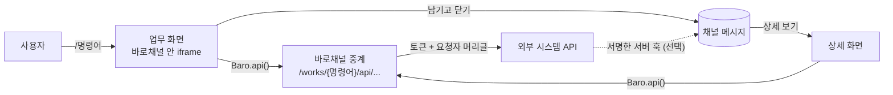

# 바로채널 업무 연동 개발 가이드

2026-11-10 · 업무 채널 v3 기준 · 설계 배경은 [work_channel.md](work_channel.md)

외부 시스템(ERP, 설비 관리, 할 일 등)을 바로채널 업무 채널에 붙이는 개발자를 위한 문서다. 외부 시스템이 만들 API, 바로채널 안에 둘 업무 화면, 외부 시스템이 채널에 직접 메시지를 남기는 서버 훅을 차례로 설명한다. 동작하는 예제는 샘플 할 일 시스템([samples/todo_api.py](samples/todo_api.py))과 그 화면([src/app/templates/works/todo/](src/app/templates/works/todo/), [src/app/static/works/todo.js](src/app/static/works/todo.js))이다.

## 1. 한눈에 보기



- 사용자가 업무 채널에 `/명령어`를 입력하면 그 명령어에 연결된 **업무 화면**이 팝업으로 열린다.
- 업무 화면은 외부 시스템을 직접 부르지 않는다. 바로채널이 요청을 **중계**하면서 연동 토큰과 요청한 사람의 정보를 붙인다.
- 화면에서 처리를 마친 사용자가 **남기고 닫기**를 누르면 화면이 정한 메시지가 채널에 새 글로 남는다. **닫기**를 누르면 아무것도 남지 않는다.
- 남긴 메시지는 고칠 수 없다. 상태가 바뀌면 새 메시지를 남긴다.
- 외부 시스템이 **서버 훅**으로 채널에 직접 메시지를 남길 수도 있다(선택).

### 역할 분담

| 누가 | 무엇을 |
| --- | --- |
| 외부 시스템 개발자 | JSON API(2절), 필요하면 서버 훅 송신(4절) |
| 업무 화면 개발자 | 바로채널 저장소의 `templates/works/{화면}/`과 `static/works/`(3절). 외부 시스템 개발자가 만들어도 되지만 바로채널 저장소에 넣고 코드 리뷰를 거친다 |
| 바로채널 시스템 관리자 | 외부 시스템 호스트를 `BARO_INTEGRATION_ALLOWED_HOSTS`에 등록 |
| 그룹 관리자 | 채널 설정에서 명령어 등록(화면, 연동 주소, 토큰), 서버 훅 키 발급 |

### 연동 순서

1. 외부 시스템 개발자가 API를 만들고 바로채널 전용 토큰을 발급한다.
2. 바로채널 시스템 관리자에게 호스트 등록을 요청한다. 예: `erp.internal` 또는 `erp.internal:8443`
3. 업무 화면을 만들어 바로채널 저장소에 올리고 리뷰를 받아 배포한다.
4. 그룹 관리자가 채널 설정 → 명령어에서 이름, 화면, 연동 주소, 토큰을 넣어 등록한다.
5. 필요하면 같은 화면에서 **훅 키 발급**을 눌러 서버 훅 주소와 키를 받아 외부 시스템에 설정한다.

## 2. 외부 시스템 API 만들기

바로채널 전용 규격은 없다. 평범한 JSON API면 되고, 아래 규칙만 지키면 된다.

### 2.1 주소

- **연동 주소**는 명령어마다 등록하는 기준 주소다. 예: `https://erp.internal/api/leave`
- 화면이 `Baro.api("GET", "requests/17")`을 부르면 바로채널은 `{연동 주소}/requests/17`을 부른다. 쿼리 문자열(`?q=...`, 2,000자까지)은 그대로 붙는다.
- 경로의 각 마디는 영문, 숫자, `_ . ~ -`만 쓸 수 있고 100자까지다. `.`과 `..`은 쓸 수 없다. **문서 번호 같은 식별자도 이 글자 안에서 만든다.**
- 화면이 부를 수 있는 경로는 화면 정의(`screen.toml`)에 적힌 것뿐이다. 외부 시스템의 다른 API는 바로채널을 통해 불릴 일이 없다.

### 2.2 인증

모든 요청에 다음 머리글이 붙는다. 반드시 확인한다.

```
Authorization: Bearer {명령어에 등록한 토큰}
```

- 토큰은 바로채널 전용으로 발급한다. 다른 시스템과 같이 쓰지 않는다.
- 바로채널은 토큰을 화면에 다시 보여주지 않고 브라우저로도 보내지 않는다. 바꿀 때는 새 토큰을 발급해 그룹 관리자에게 등록을 요청한다.

### 2.3 요청한 사람

바로채널이 확인한 로그인 사용자를 머리글로 알려준다. **권한 판정은 외부 시스템이 이 사람 기준으로 한다.** 바로채널은 "이 채널에서 이 업무를 쓸 수 있는 사람"까지만 보장한다.

| 머리글 | 값 | 예 |
| --- | --- | --- |
| `X-Baro-User-Id` | 바로채널 사용자 번호 | `12` |
| `X-Baro-User-Email` | 이메일, 퍼센트 인코딩 | `sa1@baro.example` |
| `X-Baro-User-Name` | 이름, 퍼센트 인코딩 | `%EC%A0%95%EC%98%81%EC%97%85`(정영업) |
| `X-Baro-Channel-Id` | 채널 번호 | `7` |
| `X-Baro-Command` | 명령어 이름, 퍼센트 인코딩 | `add` |
| `Idempotency-Key` | 화면이 요청한 경우만. 영문, 숫자, `_ -` 8~64자 | `3f2a...` |

- 이름처럼 한글이 들어가는 값은 퍼센트 인코딩돼 있으니 디코딩해서 쓴다(Python `urllib.parse.unquote`, Java `URLDecoder.decode(value, UTF_8)`).
- 이 머리글은 토큰이 맞는 요청에서만 믿는다. 사내 사용자 대장과 맞출 때는 이메일을 기준으로 삼는 것을 권한다.

### 2.4 요청 본문

- 본문은 JSON이고 `Content-Type: application/json`으로 온다. 100KB까지다.
- 바로채널은 본문을 고치지 않고 그대로 넘긴다. 형식과 값의 검사는 외부 시스템이 한다.

### 2.5 응답

응답은 JSON으로 한다(빈 본문은 허용). 바로채널은 상태 코드와 본문을 화면에 그대로 넘기되, 아래 경우는 바꾼다.

| 외부 응답 | 화면이 받는 것 |
| --- | --- |
| 2xx, 4xx와 JSON 본문 | 그대로 |
| 본문이 JSON이 아님 | 502 `{"error": "외부 시스템의 응답이 JSON이 아닙니다."}` |
| 3xx(리다이렉트) | 502. 리다이렉트는 따라가지 않는다 |
| 5xx | 502 `{"error": "외부 시스템에서 오류가 났습니다."}`. 외부 본문은 숨긴다 |
| 1MB 넘는 본문 | 502 |
| 시간 초과(기본 5초) | 504 |
| 연결 실패 | 502 |

- 외부 응답의 머리글(쿠키 등)은 넘기지 않는다. 세션이나 쿠키에 기대지 않는다.
- 4xx는 사용자에게 보일 문장을 담는 것을 권한다. 화면은 이 문장을 그대로 보여주기 쉽다.

  ```json
  {"detail": "이미 승인된 신청은 취소할 수 없습니다."}
  ```

- 입력값 오류는 422와 항목별 문장으로 주는 것을 권한다.

  ```json
  {"errors": {"title": "제목을 입력해 주세요.", "due": "마감일은 오늘 이후여야 합니다."}}
  ```

### 2.6 중복 방지

- 등록처럼 무언가를 만드는 요청에서 화면이 `idempotent`를 켜면 `Idempotency-Key`가 온다. 같은 키로 다시 오면 **새로 만들지 말고 처음 결과를 돌려준다.** 네트워크가 끊겨 사용자가 다시 눌러도 한 번만 만들어진다.
- 키는 팝업을 열 때마다 바뀐다.

### 2.7 응답 시간

- 기본 5초 안에 답한다(바로채널 설정 `BARO_INTEGRATION_TIMEOUT_SECONDS`, 최대 30초).
- 오래 걸리는 처리는 접수만 하고 바로 답한다. 끝나면 서버 훅(4절)으로 채널에 알린다.

### 2.8 바꿀 때 주의

화면 코드는 바로채널과 함께 배포된다. API의 경로나 응답 모양을 바꿀 때는 이전 모양을 함께 유지하거나, 화면 배포와 날짜를 맞춘다.

### 2.9 예: 샘플 할 일 시스템

| 요청 | 하는 일 |
| --- | --- |
| `GET {연동 주소}/options` | 고를 수 있는 값(우선순위, 상태). 화면이 선택 목록을 DB 값으로 그린다 |
| `GET {연동 주소}?q=&status=&assignee=` | 찾기 `{"items": [...], "total": n}` |
| `POST {연동 주소}` | 등록. `Idempotency-Key`가 같으면 처음 결과 |
| `GET {연동 주소}/{id}` | 하나 보기. 지금 할 수 있는 동작(`actions`)을 싣는다 |
| `POST {연동 주소}/{id}/actions/{key}` | 동작(시작, 완료, 다시 열기). 요청자를 `X-Baro-User-Name`에서 읽는다 |

## 3. 업무 화면 만들기

업무 화면은 바로채널 저장소에 코드로 둔다. 관리자 화면에서 올리거나 고칠 수 없다. 화면은 사용자의 로그인 세션으로 실행되기 때문에 리뷰를 거친 코드만 화면이 된다.

### 3.1 파일 구성

```
src/app/templates/works/
  base.html              # 공통 틀. 고치지 않는다
  leave/                 # 화면 이름 = 폴더 이름 (영문 소문자로 시작, 영문 소문자·숫자·_ 2~40자)
    screen.toml          # 화면 정의
    index.html           # 시작 화면
    detail.html          # 상세 화면 (선택)
src/app/static/works/
  baro-work.js           # SDK. 고치지 않는다
  leave.js               # 이 화면의 스크립트
```

### 3.2 화면 정의 `screen.toml`

```toml
title = "휴가"
description = "휴가 신청과 조회"
detail = "detail"        # 상세 화면 파일 이름. 없으면 메시지에 상세 보기를 달 수 없다
size = "medium"          # 팝업 크기: 프리셋 이름 또는 { width = 640, height = 600 } (px)

# 화면이 부를 수 있는 외부 API. "메서드 경로"이고 경로는 연동 주소 뒤에 붙는다.
# {이름}은 경로 한 마디와 맞는다. "POST "처럼 경로가 비면 연동 주소 자체다.
api = [
  "GET types",
  "POST requests",
  "GET requests/{id}",
  "POST requests/{id}/cancel",
]

# 시작 화면과 표시 이름. 명령어를 등록할 때 이 중 하나를 고른다.
[pages]
index = "휴가 신청"

# 화면별 팝업 크기 (선택). 적지 않은 화면은 위의 size를 쓴다.
[sizes]
index = { width = 640, height = 680 }
detail = "small"
```

| 항목 | 필수 | 설명 |
| --- | --- | --- |
| `title` | 아니오 | 화면 이름. 없으면 폴더 이름 |
| `description` | 아니오 | 설명 |
| `pages` | 예 | 시작 화면 이름과 표시 이름. 같은 이름의 `.html`이 있어야 한다 |
| `detail` | 아니오 | 상세 화면 이름 |
| `size` | 아니오 | 팝업 기본 크기. 프리셋 이름 또는 `{ width, height }`(px). 기본 `medium` |
| `sizes` | 아니오 | 화면 이름(`pages`의 키나 `detail`)별 크기. 형식은 `size`와 같다 |
| `api` | 아니오 | 부를 수 있는 API. 메서드는 `GET POST PUT PATCH DELETE` |

- **팝업 크기:** 프리셋은 `small` 420×720, `medium` 560×720, `large` 840×720, `full` 창 전체다. 직접 적을 때 너비는 320~1920, 높이는 240~1200이고 한쪽만 적으면 다른 쪽은 `medium` 값이다. 창보다 크면 창에 맞춰 줄고, 휴대폰에서는 늘 전체 화면이다. 명령어로 열 때는 명령어가 고른 시작 화면의 크기를, 상세 보기는 `detail` 화면의 크기를 쓴다.
- **화면에 필요한 API만 적는다.** 적지 않은 경로는 바로채널이 404로 막는다.
- 앱이 시작할 때 모든 화면 정의를 검사한다. 틀리면 서버가 시작하지 않는다.

### 3.3 화면 템플릿

```html

<script src="{{ asset('works/leave.js') }}" defer></script>

<form id="leave-form" novalidate>
  <label><span>종류 <span class="required">*</span></span>
    <select name="type" required><option value="">불러오는 중…</option></select>
  </label>
  <label>시작일 <input name="start" type="date" required></label>
  <label>종료일 <input name="end" type="date" required></label>
  <label>사유 <textarea name="reason" rows="3" maxlength="500"></textarea></label>
  <div class="work-buttons"><button class="primary">신청</button></div>
</form>
<section id="leave-done" class="stack" hidden><p><strong>신청했습니다.</strong></p></section>

```

| 블록 | 쓰임 |
| --- | --- |
| `content` | 화면 본문 |
| `scripts` | 화면 스크립트. `static/works/`의 파일만 |
| `heading` | 제목. 기본은 `pages`의 표시 이름 |
| `title` | 브라우저 제목. 기본은 명령어 표시 이름 |

- 아래쪽 **닫기**와 **남기고 닫기** 버튼은 `base.html`이 그린다. 화면에서 따로 만들지 않는다.
- 템플릿에서는 `command`(명령어), `screen`(화면 정의), `params`(상세 파라미터), `baro`(아래 `Baro.context`와 같은 값)를 쓸 수 있다.
- 바로채널의 `app.css`가 함께 들어오므로 입력 칸과 버튼(`primary`, `soft`), `work-detail`, `work-list`, `work-buttons` 모양을 그대로 쓸 수 있다.

### 3.4 화면의 제약 (보안 정책)

업무 화면에는 다음 CSP가 걸린다.

```
default-src 'self'; script-src 'self'; style-src 'self'; img-src 'self' data:;
font-src 'self'; connect-src 'self'; frame-ancestors 'self'; base-uri 'none';
form-action 'none'; object-src 'none'
```

- **인라인 스크립트(`<script>...</script>`, `onclick=`)는 실행되지 않는다.** 스크립트는 `static/works/`에 파일로 둔다.
- **`style=""` 속성은 적용되지 않는다.** 필요한 모양은 CSS 파일로 둔다.
- **외부 주소(CDN, 외부 API)를 부를 수 없다.** 외부 API는 `Baro.api()`로만 부른다.
- **폼을 그대로 전송할 수 없다.** `submit` 이벤트에서 `preventDefault()`를 하고 `Baro.api()`로 보낸다.
- **외부 응답 값은 `textContent`로만 넣는다.** `innerHTML`, `insertAdjacentHTML`을 쓰지 않는다.

### 3.5 SDK `Baro`

`base.html`이 `static/works/baro-work.js`를 먼저 불러온다. 화면 스크립트는 `window.Baro`를 쓴다.

| 함수 | 설명 |
| --- | --- |
| `Baro.context` | 지금 화면의 정보(아래 표) |
| `await Baro.api(method, path, { query, body, idempotent })` | 외부 API 호출. `{ ok, status, data }`를 돌려준다. 바로채널에 닿지 못하면 `status`는 0이다 |
| `Baro.message(msg)` | 남길 메시지를 정한다. **남기고 닫기**가 켜진다. `null`이면 꺼진다 |
| `await Baro.people(q)` | 바로채널 사용자 찾기. `[{ id, name, email }]`, 최대 20명 |
| `Baro.status(text, { error })` | 아래쪽 상태 문구 |
| `Baro.errorText(result, fallback)` | 오류 응답에서 보여줄 문장(`error`, `detail` 순) |
| `Baro.close()` | 아무것도 남기지 않고 닫는다 |

- `path`는 연동 주소 뒤에 붙을 경로다. 식별자는 `encodeURIComponent`로 감싼다.
- `query`의 빈 값은 보내지 않는다.
- `idempotent: true`면 팝업의 키를 `Idempotency-Key`로 보낸다. 글자를 주면 그 글자를 키로 쓴다.
- 사용자가 입력을 시작한 뒤 Esc나 바깥을 누르면 바로채널이 닫을지 묻는다. **닫기** 버튼은 묻지 않는다.

`Baro.context`의 값은 다음과 같다.

| 값 | 설명 |
| --- | --- |
| `user` | `{ id, name, email }` 지금 사용자 |
| `channel` | `{ id, name }` |
| `command` | `{ id, name, label }` |
| `page` | 지금 화면 이름(`index`, `detail` 등) |
| `params` | 상세 화면일 때 메시지에 담았던 `detail` 값. 그 밖에는 `{}` |
| `reply_to` | 상세 화면일 때 원래 메시지 번호. 남기면 그 쓰레드의 답글이 된다 |
| `can_write` | 처리(변경)할 수 있는지. 거짓이면 처리 버튼을 감춘다 |
| `can_leave` | 메시지를 남길 수 있는지. 거짓이면 **남기고 닫기**가 없다 |

`can_write`, `can_leave`는 화면을 그리기 위한 값이다. 바로채널이 요청마다 권한을 다시 확인하고, 외부 시스템도 따로 확인해야 한다.

### 3.6 남길 메시지

화면은 처리를 마친 뒤 시스템이 요구하는 내용으로 메시지를 정한다. 남길지는 사용자가 **남기고 닫기**와 **닫기** 중에서 고른다.

```js
Baro.message({
  text: "휴가를 신청했습니다: 연차 11/20~11/21",
  fields: [
    { label: "상태", value: "승인 대기" },
    { label: "기간", value: "2일" },
  ],
  detail: { id: "LV-2026-0042" },
  link: { label: "ERP에서 열기", url: "https://erp.internal/leave/LV-2026-0042" },
});
```

| 항목 | 규칙 |
| --- | --- |
| `text` | 필수. 1~1,000자 일반 텍스트. 마크다운과 HTML은 해석하지 않고 줄바꿈만 살린다 |
| `fields` | 선택. 최대 6개. `label` 30자, `value` 200자 |
| `detail` | 선택. 상세 화면에 넘길 값. 최대 5개, 이름은 영문·숫자·`_ -` 50자, 값은 100자 글자. 화면 정의에 `detail`이 있어야 한다 |
| `link` | 선택. http(s) 주소이고 호스트가 허용 목록에 있어야 한다. 새 탭으로 열린다. `label`이 없으면 "열기" |
| `reply_to` | 선택. 같은 채널의 메시지 번호. 상세 화면에서는 자동으로 원래 메시지가 들어간다 |

- 같은 팝업에서는 한 번만 남는다. 다시 누르거나 네트워크가 끊겨 다시 보내도 처음 글을 돌려준다.
- 채널의 다른 사람이 읽고 바로 이해할 문장으로 쓴다. 누가 무엇을 했고 지금 상태가 어떤지가 드러나게 한다.
- 개인정보와 비밀 값은 넣지 않는다. 메시지는 그 채널을 읽을 수 있는 모든 사람에게 보이고 검색된다.

### 3.7 상세 화면

- 메시지에 `detail`을 담으면 카드에 **상세 보기**가 붙고, 누르면 `screen.toml`의 `detail` 화면이 열린다.
- 상세 화면은 `Baro.context.params`로 받은 값으로 외부 API를 불러 최신 상태를 보여준다. 바로채널에는 업무 데이터의 사본이 없다.
- 채널 읽기 권한만 있는 사람도 상세 화면을 볼 수 있다. 처리 버튼은 `can_write`일 때만 그린다.
- 상세 화면에서 남긴 메시지는 원래 메시지의 쓰레드에 답글로 붙는다.
- 명령어를 보관하면 상세 보기가 사라진다. 메시지 자체는 남는다.

### 3.8 화면 스크립트 예

```js
// static/works/leave.js
(() => {
  "use strict";
  const Baro = window.Baro;

  async function setup() {
    const form = document.getElementById("leave-form");
    const types = await Baro.api("GET", "types");
    if (!types.ok) { Baro.status(Baro.errorText(types, "종류를 불러오지 못했습니다."), { error: true }); return; }
    const select = form.elements.type;
    select.replaceChildren();
    types.data.forEach((row) => {
      const option = document.createElement("option");
      option.value = row.code;
      option.textContent = row.label;   // 외부 값은 textContent로
      select.append(option);
    });

    form.addEventListener("submit", async (event) => {
      event.preventDefault();
      const data = Object.fromEntries(new FormData(form));
      const result = await Baro.api("POST", "requests", { body: data, idempotent: true });
      if (!result.ok) { Baro.status(Baro.errorText(result, "신청하지 못했습니다."), { error: true }); return; }
      form.hidden = true;
      document.getElementById("leave-done").hidden = false;
      Baro.status("[남기고 닫기]를 누르면 채널에 남습니다.");
      Baro.message({
        text: `휴가를 신청했습니다: ${result.data.type_label} ${data.start}~${data.end}`,
        fields: [{ label: "상태", value: result.data.status_label }],
        detail: { id: result.data.id },
      });
    });
  }

  document.addEventListener("DOMContentLoaded", () => {
    if (document.body.dataset.page === "index") setup();
  });
})();
```

### 3.9 올리기 전 확인

- [ ] `screen.toml`의 `api`에 화면이 쓰는 경로만 적었다.
- [ ] 인라인 스크립트, `style=""`, 외부 주소가 없다.
- [ ] 외부 값은 `textContent`로만 넣었다.
- [ ] 등록처럼 만드는 요청은 `idempotent: true`로 보낸다.
- [ ] 실패하면 `Baro.status(..., { error: true })`로 알리고, 입력한 값은 지우지 않는다.
- [ ] `can_write`가 거짓이면 처리 버튼을 감춘다.
- [ ] 휴대폰 폭(390px)에서 확인했다.
- [ ] `uv run pytest tests/test_work.py`가 통과한다(화면 정의 검사 포함).

## 4. 서버 훅 보내기 (선택)

외부 시스템에서 일어난 일(결재 완료, 설비 알람 등)을 채널에 새 메시지로 남긴다. 그룹 관리자가 명령어에서 **훅 키 발급**을 눌러야 켜진다. 키는 발급할 때 한 번만 보이고, 다시 발급하면 이전 키는 바로 막힌다.

### 4.1 요청

```
POST https://{바로채널}/hooks/work/{명령어 번호}
Content-Type: application/json
X-Baro-Event-Id: erp-approval-20261110-0042
X-Baro-Timestamp: 1794300000
X-Baro-Signature: sha256=5d1c...

{"text": "휴가 신청이 승인됐습니다: 연차 11/20~11/21",
 "fields": [{"label": "상태", "value": "승인 대기 → 승인"}],
 "detail": {"id": "LV-2026-0042"},
 "actor": "김팀장"}
```

| 머리글 | 규칙 |
| --- | --- |
| `X-Baro-Event-Id` | 이벤트마다 다른 값. 영문, 숫자, `_ . : -` 1~58자. 같은 값이 다시 오면 남기지 않는다 |
| `X-Baro-Timestamp` | 보내는 시각(유닉스 초). 바로채널 시각과 5분 넘게 차이 나면 거절한다 |
| `X-Baro-Signature` | `sha256=` + HMAC-SHA256(키, `"{시각}.{본문}"`)의 16진수 소문자 |

- 본문은 3.6절의 메시지 형식에 `actor`(표시할 이름, 100자)를 더한 것이다. `reply_to`는 쓸 수 없다. 본문은 10,000바이트까지다.
- 작성자는 "외부 시스템 · {actor}"로 보인다.
- 서명은 **실제로 보내는 본문 바이트 그대로** 계산한다. 서명한 뒤 본문을 다시 직렬화하면 맞지 않는다.

### 4.2 응답

| 코드 | 뜻 | 할 일 |
| --- | --- | --- |
| 202 `{"post_id": 41}` | 남겼다 | 끝 |
| 202 `{"post_id": 41, "duplicate": true}` | 이미 남긴 이벤트 | 끝 |
| 400 | `X-Baro-Event-Id`가 없거나 틀림 | 고쳐서 보낸다 |
| 401 | 서명, 시각, 키, 명령어 번호 중 하나가 틀림(어느 것인지 알리지 않는다) | 키와 서버 시각을 확인한다 |
| 409 | 명령어가 보관됨 | 다시 보내지 않는다 |
| 413 | 본문이 너무 큼 | 줄인다 |
| 422 `{"detail": "..."}` | 메시지 형식이 틀림 | 고쳐서 보낸다 |

- 네트워크 오류나 5xx면 **같은 `X-Baro-Event-Id`로** 다시 보낸다. 시각과 서명은 새로 만든다. 두 번 남지 않는다.
- 훅은 사용자 요청을 처리하는 흐름과 따로(백그라운드로) 보낸다. 바로채널이 느리거나 멈춰도 외부 시스템의 처리가 막히지 않게 한다.

### 4.3 서명 예

Python

```python
import hashlib, hmac, json, time, urllib.request, uuid

def send(url: str, secret: str, message: dict) -> int:
    body = json.dumps(message, ensure_ascii=False).encode()
    timestamp = str(int(time.time()))
    digest = hmac.new(secret.encode(), timestamp.encode() + b"." + body, hashlib.sha256)
    request = urllib.request.Request(url, body, method="POST", headers={
        "Content-Type": "application/json",
        "X-Baro-Event-Id": f"erp-{uuid.uuid4().hex}",
        "X-Baro-Timestamp": timestamp,
        "X-Baro-Signature": "sha256=" + digest.hexdigest(),
    })
    with urllib.request.urlopen(request, timeout=5) as response:
        return response.status
```

Java

```java
byte[] body = json.getBytes(StandardCharsets.UTF_8);
String timestamp = Long.toString(Instant.now().getEpochSecond());
Mac mac = Mac.getInstance("HmacSHA256");
mac.init(new SecretKeySpec(secret.getBytes(StandardCharsets.UTF_8), "HmacSHA256"));
mac.update((timestamp + ".").getBytes(StandardCharsets.UTF_8));
String signature = "sha256=" + HexFormat.of().formatHex(mac.doFinal(body));

HttpRequest request = HttpRequest.newBuilder(URI.create(url))
    .timeout(Duration.ofSeconds(5))
    .header("Content-Type", "application/json")
    .header("X-Baro-Event-Id", eventId)
    .header("X-Baro-Timestamp", timestamp)
    .header("X-Baro-Signature", signature)
    .POST(HttpRequest.BodyPublishers.ofByteArray(body))
    .build();
```

## 5. 보안 확인 목록

- [ ] 바로채널 요청의 `Authorization` 토큰을 확인한다. 토큰은 바로채널 전용이다.
- [ ] 권한은 `X-Baro-User-*`의 사람 기준으로 외부 시스템이 최종 판단한다.
- [ ] 입력값은 외부 시스템이 다시 검사한다. 화면의 검사는 편의일 뿐이다.
- [ ] 응답에 화면에 필요 없는 개인정보나 내부 값을 싣지 않는다. 화면은 사용자 브라우저에서 돈다.
- [ ] 서버 훅 키와 토큰은 설정 파일이나 비밀 저장소에 두고 코드와 로그에 남기지 않는다.
- [ ] 훅은 이벤트마다 다른 `X-Baro-Event-Id`를 쓰고, 서버 시각을 맞춰 둔다(NTP).

## 6. 문제 해결

| 증상 | 원인과 조치 |
| --- | --- |
| 명령어 등록 시 "허용되지 않은 호스트" | 시스템 관리자에게 `BARO_INTEGRATION_ALLOWED_HOSTS` 등록을 요청한다 |
| 화면에서 502 "연결하지 못했습니다" | 연동 주소, 방화벽, 외부 서버 상태를 확인한다 |
| 502 "JSON이 아닙니다", "오류가 났습니다" | 외부 응답이 HTML이거나 리다이렉트, 5xx다. 외부 로그를 본다 |
| 504 | 5초 안에 답하지 못했다. 처리를 비동기로 바꾼다 |
| 404 "화면에 등록되지 않은 API" | `screen.toml`의 `api`에 그 메서드와 경로가 없다. 경로 마디의 글자도 확인한다 |
| 403 "이 업무를 쓸 권한이 없습니다" | 채널 쓰기 권한이 없는 사람이 GET이 아닌 요청을 했다 |
| 429 | 사용자 한 명이 1분에 120번 넘게 불렀다. 입력마다 부르는 곳에 지연(0.3초)을 둔다 |
| **남기고 닫기**가 꺼져 있다 | 화면이 아직 `Baro.message()`를 부르지 않았다 |
| **남기고 닫기**가 없다 | 그 사람에게 채널 쓰기(상세 화면은 답글쓰기) 권한이 없다 |
| 메시지에 **상세 보기**가 없다 | `detail`을 담지 않았거나, 화면 정의에 `detail`이 없거나, 명령어가 보관됐다 |
| 화면의 버튼이 동작하지 않는다 | 브라우저 콘솔에서 CSP 위반을 확인한다. 인라인 스크립트나 `onclick=`을 쓰지 않는다 |
| 서버 훅이 401 | 키를 다시 발급했는지, 서명에 쓴 본문과 보낸 본문이 같은지, 서버 시각이 맞는지 확인한다 |

## 7. 개발 환경에서 해 보기

1. 샘플 할 일 시스템을 띄운다: `uv run samples/todo_api.py` (포트 8100)
2. `.env`에 `BARO_INTEGRATION_ALLOWED_HOSTS=127.0.0.1:8100`을 둔다.
3. 바로채널을 띄우고 샘플 계정(`sa1@baro.example`)으로 영업 그룹의 "할 일" 채널에서 `/add`, `/find`를 실행한다.
4. 새 화면은 `templates/works/`에 폴더를 만들고 서버를 다시 시작한 뒤, 채널 설정에서 명령어를 등록해 확인한다.
5. 서버 훅은 채널 설정에서 키를 발급받아 다음처럼 띄운 뒤, `PATCH /todos/{id}`로 상태를 바꿔 본다.

   ```bash
   TODO_WEBHOOK_URL=http://127.0.0.1:8000/hooks/work/1 TODO_WEBHOOK_SECRET=발급받은키 uv run samples/todo_api.py
   ```
